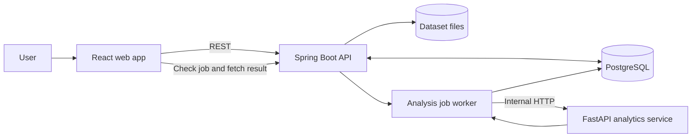

# DataMind

**DataMind helps users turn tabular files into structured data profiles, statistical summaries, and machine-learning results.** It brings together a web interface, a public application API, persistent dataset and job records, and a dedicated analytics service.

This README introduces the project in six parts: what it is, why it is useful, how the repository is organized, the reasoning behind its design, the capabilities available today, and how to run it locally.

## Contents

1. [What is DataMind?](#1-what-is-datamind)
2. [Motivation behind the project](#2-motivation-behind-the-project)
3. [Project structure](#3-project-structure)
4. [Project design: what and why](#4-project-design-what-and-why)
5. [Current product capabilities](#5-current-product-capabilities)
6. [How to run the project](#6-how-to-run-the-project)
7. [API quick reference](#7-api-quick-reference)
8. [Tests and build](#8-tests-and-build)
9. [Scope and further documentation](#9-scope-and-further-documentation)

## 1. What is DataMind?

DataMind is a data-analysis application for working with structured datasets such as CSV, Excel, JSON, and Parquet files. A user uploads a dataset, selects an analysis, and receives a result that can be inspected in the web interface or retrieved through the API.

The system separates user-facing application workflows from analytical computation:



The backend accepts a request and creates a job. A worker processes that job using the Python service, persists the result, and exposes the job state and result to the client.

## 2. Motivation behind the project

Before analysis begins, people often need to answer practical questions: How large is this dataset? Which columns are missing values? Are there unusual values, repeated records, or columns that will not help a model? Which relationships or patterns deserve closer attention?

DataMind brings these first analysis steps into one workflow. It can be useful for:

- **Students and people learning data science** who want to explore a dataset and see how profiling, statistics, and basic modeling fit together.
- **Analysts and researchers** who need a quick first pass over a new tabular dataset before doing deeper work in a notebook or specialist tool.
- **Developers learning data platforms** who want to study file ingestion, API design, background jobs, relational persistence, service boundaries, and Python analytics integration in one codebase.
- **Teams prototyping an analysis workflow** that needs dataset versions and job results to remain traceable during development.

The project is intended to make common exploratory workflows easier to start and easier to repeat. Its data-quality flags are signals for investigation; they do not replace domain knowledge or expert review.

## 3. Project structure

```text
DataMind/
├── analytics/                       # Python analytics service
│   ├── app/
│   │   ├── api/                      # Internal FastAPI endpoints
│   │   ├── loaders/                  # Dataset readers
│   │   ├── registry/                 # Analysis service registration
│   │   └── services/                 # EDA, statistics, ML, cleaning, insights, charts
│   ├── test/                         # pytest suites
│   └── requirements.txt
├── backend/
│   └── datamind-api/                 # Java Spring Boot public API
│       └── src/
│           ├── main/java/            # Controllers, services, entities, workers
│           ├── main/resources/       # Configuration and Flyway migrations
│           └── test/                 # Unit, repository, and integration tests
├── frontend/
│   └── datamind-web/                 # React/Vite web application
│       └── src/                      # Pages, API clients, dashboards, tests
├── docs/                             # Product, API, schema, workflow documents
├── CODE_REVIEW_LOG.md                # Findings, implementation notes, verification
└── README.md
```

### Main technologies

| Area | Technology |
|---|---|
| User interface | React, Vite, Recharts |
| Application API and job orchestration | Java 21, Spring Boot, Spring Data JPA |
| Persistent metadata and results | PostgreSQL, Flyway |
| Analytics and ML | Python, FastAPI, Pandas, NumPy, SciPy, scikit-learn |
| Automated checks | Vitest and Testing Library, pytest, Maven tests, Oxlint |

## 4. Project design: what and why

1. **Separate public APIs from analytics execution.** Spring Boot is the browser-facing API; FastAPI handles internal analysis requests. This keeps request validation, persistence, and job state separate from data-science code.
2. **Run analysis as background jobs.** Analysis can take longer than a normal web request. The API returns a job identifier and state, while a worker handles execution and clients can check progress separately.
3. **Persist both metadata and results.** PostgreSQL stores dataset records, versions, lineage, job state, and structured results so work can be revisited after the initial request finishes.
4. **Keep dataset files outside the relational database.** Files are written to the configured filesystem path; the database holds their metadata and storage reference. This avoids using the database as a binary file store.
5. **Track dataset identity and versions.** Content hashing helps recognize repeated uploads, while logical dataset versions and lineage preserve the relationship between source and derived data.
6. **Organize analytics into focused services.** Profiling, statistical analysis, machine learning, cleaning, insight generation, and visualization are separate modules. This makes their behavior easier to evolve and test.
7. **Use explicit job states and retries.** `PENDING`, `PROCESSING`, `COMPLETED`, and `FAILED` make progress visible. Configurable retry behavior helps the worker handle temporary service failures.
8. **Return structured visualization data.** Analytics responses can include visualization specifications, allowing the frontend to render analysis results without embedding chart logic in the Python service.

## 5. Current product capabilities

### Dataset handling

- Upload CSV, Excel (`.xlsx`/`.xls`), JSON, and Parquet datasets.
- Store file content on disk and dataset metadata in PostgreSQL.
- Calculate content hashes and detect repeated content within a logical dataset family.
- Keep dataset versions and record lineage for generated or transformed versions.
- Select a specific dataset version before starting an analysis; each job stores the chosen version ID.

### Analysis and insights

- **EDA:** dimensions, column types, missing values, descriptive summaries, duplicate rows, category frequencies, rare categories, constant columns, high-cardinality columns, and potential outliers.
- **Statistical analysis:** descriptive and distribution summaries, correlations, covariance, and supported diagnostics.
- **Supervised machine learning:** regression or classification when a target column is supplied, including preprocessing and evaluation output.
- **Unsupervised machine learning:** numeric-feature K-Means clustering and PCA when no target column is supplied.
- **Insights and visualizations:** insight generation and visualization specifications for EDA, statistical, and machine-learning dashboards.
- **Cleaning workflow:** review quality recommendations for a selected version, preview supported operations without changing the source, then apply them to create a new version with lineage.

The analysis types currently registered in the Python service are `EDA`, `STATISTICAL`, `MACHINE_LEARNING`, and `INSIGHT`. Although time-series and text analysis appear in the wider type model/product direction, they are not currently available as executable analysis workflows.

## 6. How to run the project

Run PostgreSQL, the Python service, the Spring Boot API, and the web app in separate terminals. Commands below start from the repository root unless a `cd` command changes the directory.

### Prerequisites

- Java 21
- Maven 3.9 or later
- Python 3.10 or later, compatible with the installed scientific Python packages
- Node.js and npm compatible with the Vite version in `frontend/datamind-web/package.json`
- PostgreSQL

### 6.1 Prepare PostgreSQL

Create a local database named `datamind` and ensure the configured user can connect. For example, in `psql`:

```sql
CREATE DATABASE datamind;
```

The backend defaults to `localhost:5432`, username `postgres`, and database `datamind`. Flyway applies schema migrations when the backend starts. Provide the database password through the `DB_PASSWORD` environment variable.

### 6.2 Install and run the analytics service

```bash
cd analytics
python -m venv .venv
```

Activate the environment:

```powershell
# Windows PowerShell
.venv\Scripts\Activate.ps1
```

```bash
# macOS/Linux
source .venv/bin/activate
```

Install the Python dependencies and start the service:

```bash
python -m pip install -r requirements.txt
python -m uvicorn app.main:app --reload --host 127.0.0.1 --port 8000
```

Confirm it is running at `http://127.0.0.1:8000/health`.

### 6.3 Run the Spring Boot API

Open another terminal at the repository root. Set `DB_PASSWORD` for that terminal, then start the backend:

```powershell
# Windows PowerShell
$env:DB_PASSWORD = "<your-postgres-password>"
cd backend/datamind-api
mvn spring-boot:run
```

```bash
# macOS/Linux
export DB_PASSWORD='<your-postgres-password>'
cd backend/datamind-api
mvn spring-boot:run
```

The public API is available at `http://localhost:8080`. The backend connects to the analytics service at `http://127.0.0.1:8000` by default. Database, Python-service, upload-size, and storage settings are in `backend/datamind-api/src/main/resources/application.properties`.

### 6.4 Install and run the web app

In a third terminal:

```bash
cd frontend/datamind-web
npm install
```

Create `frontend/datamind-web/.env.local`:

```dotenv
VITE_API_BASE_URL=http://localhost:8080
```

Start Vite:

```bash
npm run dev
```

Open the local URL printed in the terminal. The browser communicates with the Spring Boot API; the Python service is called by the backend.

### 6.5 Use the application

1. Upload a supported dataset in the web app.
2. Choose EDA, statistical analysis, insights, or machine learning.
3. For supervised machine learning, provide a target column. Leave the target blank for numeric-feature clustering.
4. Submit the analysis. The API creates a job and returns its current state.
5. Follow the job until it reaches `COMPLETED` or `FAILED`; retrieve the persisted result when complete.

## 7. API quick reference

The public API is served by Spring Boot at `http://localhost:8080`.

| Method | Endpoint | Purpose |
|---|---|---|
| `POST` | `/api/datasets` | Upload a file using multipart form field `file`; optional `datasetId` associates it with a logical dataset. |
| `GET` | `/api/datasets` | List dataset records. |
| `GET` | `/api/datasets/{datasetVersionId}` | Retrieve one version's metadata. |
| `GET` | `/api/datasets/{logicalDatasetId}/versions` | List dataset versions. |
| `GET` | `/api/datasets/{logicalDatasetId}/versions/{versionNumber}` | Retrieve a specific version. |
| `GET` | `/api/datasets/{logicalDatasetId}/current` | Retrieve the current version. |
| `GET` | `/api/datasets/{datasetVersionId}/lineage` | Retrieve version lineage. |
| `POST` | `/api/analysis/jobs` | Create an asynchronous analysis job; returns `202 Accepted`. |
| `GET` | `/api/analysis/jobs/{id}` | Check job status. |
| `GET` | `/api/analysis/jobs/{jobId}/result` | Retrieve the persisted result. |

Example request for unsupervised ML:

```json
{
  "logicalDatasetId": "93e48716-70f6-468e-8c34-9efe055926eb",
  "datasetVersionId": "f528134c-110c-441c-a693-a09955d07698",
  "analysisType": "MACHINE_LEARNING",
  "targetColumn": null,
  "enableHyperparameterTuning": false
}
```

For supervised machine learning, set `enableHyperparameterTuning` to `true`
to opt into the random forest grid search when a random forest model is selected.
The default is `false`.

The internal Python endpoints `/internal/analyze` and `/internal/clean` are service-to-service interfaces. Full request and response details are available in [API endpoint documentation](docs/API_ENDPOINTS.md) and [API contracts](<docs/API_CONTRACTS(1).md>).

## 8. Tests and build

### Analytics

```bash
cd analytics
python -m pytest -q
```

### Backend

The backend tests use a PostgreSQL database named `datamind_test` and require `DB_PASSWORD`. Java/Python end-to-end tests also require the analytics service to be running.

```bash
cd backend/datamind-api
mvn test
```

### Frontend

```bash
cd frontend/datamind-web
npm test
npm run lint
npm run build
```

## 9. Scope and further documentation

DataMind is an actively developed V1 project. Authentication, multi-tenant access controls, cloud object storage, cloud deployment, and executable time-series/text analysis are outside the current implementation baseline. Dataset quality indicators are diagnostic heuristics and should be interpreted in context.

- [Product definition](docs/DataMind_Product_Definition_V1.md)
- [API endpoints](docs/API_ENDPOINTS.md)
- [API contracts](<docs/API_CONTRACTS(1).md>)
- [Database schema](<docs/DATABASE_SCHEMA(1).md>)
- [Use cases and workflows](docs/USE_CASES_AND_WORKFLOWS.md)
- [Code review and implementation log](CODE_REVIEW_LOG.md)
