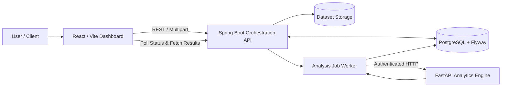

# DataMind

[](https://github.com/Hariom-55/DataMind/actions/workflows/ci.yml)
[](LICENSE)
[](https://adoptium.net/)
[](https://spring.io/projects/spring-boot)
[](https://www.python.org/)
[](https://fastapi.tiangolo.com/)
[](https://react.dev/)
[](https://www.postgresql.org/)

**DataMind turns tabular data into structured data profiles, statistical insights, diagnostic summaries, and machine-learning models.** It combines a responsive React dashboard, a robust Spring Boot orchestration API, persistent dataset versioning in PostgreSQL, and an internal FastAPI analytics engine.

---

## Table of Contents

1. [Overview & Architecture](#1-overview--architecture)
2. [Key Features](#2-key-features)
3. [Technology Stack](#3-technology-stack)
4. [Repository Structure](#4-repository-structure)
5. [Getting Started Locally](#5-getting-started-locally)
   - [Prerequisites](#prerequisites)
   - [Step 1: Database Setup (PostgreSQL)](#step-1-database-setup-postgresql)
   - [Step 2: Analytics Service (FastAPI)](#step-2-analytics-service-fastapi)
   - [Step 3: Backend API (Spring Boot)](#step-3-backend-api-spring-boot)
   - [Step 4: Web Application (React + Vite)](#step-4-web-application-react--vite)
6. [API Reference](#6-api-reference)
7. [Testing & Quality Assurance](#7-testing--quality-assurance)
8. [License](#8-license)

---

## 1. Overview & Architecture

DataMind decouples public user-facing application workflows, database persistence, and job queue orchestration from computational data science workloads:



### Core Architecture Highlights
* **Separation of Concerns**: Spring Boot handles authentication, file validation, transactional versioning, and job dispatching. FastAPI handles CPU-bound calculations, data profiling, statistical tests, and scikit-learn models.
* **Asynchronous Execution & Concurrency**: Long-running analyses execute as background jobs. Database locking (`FOR UPDATE SKIP LOCKED`) ensures safe job distribution across worker threads.
* **Pessimistic Version Locking**: Logical datasets are protected against concurrent mutation races using pessimistic root locking before allocating new version records.
* **Deep Health Observability**: Integrated Spring Boot Actuator (`/actuator/health`) probes database connectivity and monitors the analytics service.

---

## 2. Key Features

### 📁 Ingestion & Dataset Versioning
* **Multi-Format Ingestion**: Supports CSV, Excel (`.xlsx`, `.xls`), JSON, and Parquet.
* **Content Signature Validation**: Inspects file headers (magic bytes) to prevent extension spoofing.
* **Immutable Versioning**: Computes SHA-256 hashes to prevent redundant storage and maintain lineage for every cleaning and transformation step.

### 📊 Exploratory Data Analysis (EDA)
* Column type inference, missing value detection, distribution quantiles, category frequencies, constant features, high-cardinality detection, and outlier scanning.

### 📈 Statistical Analysis & Hypothesis Testing
* Correlation and covariance matrices, distribution tests, skewness, kurtosis, and configurable hypothesis tests (e.g., Pearson, Spearman, T-tests, Chi-square).

### 🤖 Machine Learning Engine
* **Supervised Learning**: Automatic problem detection (regression vs. classification), cross-validation, candidate model evaluation, feature importance, and optional hyperparameter grid search.
* **Unsupervised Learning**: Numeric-feature K-Means clustering and Principal Component Analysis (PCA).

### 🧹 Non-Destructive Data Cleaning
* Quality recommendations, previewing changes without touching the original data, and applying cleaning operations to generate traceable, versioned child datasets.

---

## 3. Technology Stack

| Layer | Technologies |
|---|---|
| **Frontend** | React 19, Vite, Recharts, Lucide Icons |
| **Backend API** | Java 21, Spring Boot, Spring Data JPA, Hibernate, Actuator |
| **Database & Migrations** | PostgreSQL 16, Flyway Migrations (`V1`–`V5`) |
| **Analytics Engine** | Python 3.11+, FastAPI, Pandas, NumPy, SciPy, Scikit-learn, PyArrow |
| **Testing & CI** | Vitest, Testing Library, Pytest, Maven Surefire, GitHub Actions |

---

## 4. Repository Structure

```text
DataMind/
├── .github/
│   └── workflows/ci.yml             # Automated multi-job CI workflow
├── analytics/                        # Python FastAPI analytics service
│   ├── app/                          # Routers, loaders, ML, statistics, profiling
│   ├── test/                         # Pytest test suite
│   ├── pytest.ini                    # Pytest configuration
│   └── requirements.txt              # Python dependencies
├── backend/
│   └── datamind-api/                 # Spring Boot application
│       └── src/
│           ├── main/java/            # Controllers, services, workers, actuator
│           ├── main/resources/       # Configuration & Flyway SQL migrations
│           └── test/                 # Integration and unit tests
├── frontend/
│   └── datamind-web/                 # React web application
│       └── src/                      # Dashboards, components, API clients
├── docs/                             # Architecture contracts, schema & product specs
├── LICENSE                           # MIT License
└── README.md
```

---

## 5. Getting Started Locally

### Prerequisites
* **Java 21** or later
* **Node.js 22** or later and `npm`
* **Python 3.11** or later
* **PostgreSQL** running locally on port `5432`

---

### Step 1: Database Setup (PostgreSQL)

Create a local database named `datamind`:

```sql
CREATE DATABASE datamind;
```

Flyway automatically applies all schema migrations (`V1` through `V5`) when the backend starts.

---

### Step 2: Analytics Service (FastAPI)

1. Navigate to the `analytics` directory and create a virtual environment:
   ```bash
   cd analytics
   python -m venv venv
   ```
2. Activate the environment:
   * **Windows (PowerShell)**: `.\venv\Scripts\Activate.ps1`
   * **macOS / Linux**: `source venv/bin/activate`
3. Install dependencies:
   ```bash
   python -m pip install --upgrade pip
   pip install -r requirements.txt
   ```
4. Start the service:
   ```bash
   python -m uvicorn app.main:app --reload --host 127.0.0.1 --port 8000
   ```
   *Health check endpoint:* `http://127.0.0.1:8000/health`

---

### Step 3: Backend API (Spring Boot)

1. In a new terminal, navigate to `backend/datamind-api`:
   ```bash
   cd backend/datamind-api
   ```
2. Set your PostgreSQL password and start the application:
   * **Windows (PowerShell)**:
     ```powershell
     $env:DB_PASSWORD = "your_postgres_password"
     .\mvnw.cmd spring-boot:run
     ```
   * **macOS / Linux**:
     ```bash
     export DB_PASSWORD='your_postgres_password'
     ./mvnw spring-boot:run
     ```
   *API root:* `http://localhost:8080`  
   *Actuator health check:* `http://localhost:8080/actuator/health`

---

### Step 4: Web Application (React + Vite)

1. In a third terminal, navigate to `frontend/datamind-web`:
   ```bash
   cd frontend/datamind-web
   npm install
   ```
2. Ensure `frontend/datamind-web/.env` contains:
   ```dotenv
   VITE_API_BASE_URL=http://localhost:8080
   ```
3. Start the Vite development server:
   ```bash
   npm run dev
   ```
4. Open the displayed local URL (typically `http://localhost:5173`) in your browser.

---

## 6. API Reference

### Public Application Endpoints (Spring Boot)

| HTTP Method | Endpoint | Description |
|---|---|---|
| `GET` | `/health` | Aggregate application health (checks DB & FastAPI) |
| `GET` | `/actuator/health` | Spring Boot Actuator deep health status & probes |
| `POST` | `/api/datasets` | Upload a dataset (Multipart `file`; optional `logicalDatasetId`) |
| `GET` | `/api/datasets` | List all root datasets |
| `GET` | `/api/datasets/{datasetVersionId}` | Retrieve a specific dataset version's metadata |
| `GET` | `/api/datasets/{logicalDatasetId}/versions` | List all versions in a dataset family |
| `GET` | `/api/datasets/{logicalDatasetId}/current` | Get the latest version in a dataset family |
| `GET` | `/api/datasets/{datasetVersionId}/lineage` | Retrieve transformation and cleaning lineage |
| `POST` | `/api/analysis/jobs` | Enqueue an analysis job (`EDA`, `STATISTICAL`, `MACHINE_LEARNING`, `INSIGHT`) |
| `GET` | `/api/analysis/jobs/{jobId}` | Poll job execution status |
| `GET` | `/api/analysis/jobs/{jobId}/result` | Fetch structured analysis results and chart specs |
| `POST` | `/api/datasets/{versionId}/cleaning/preview` | Preview results of candidate cleaning operations |
| `POST` | `/api/datasets/{versionId}/cleaning/apply` | Apply operations and generate a new immutable version |

---

## 7. Testing & Quality Assurance

DataMind maintains continuous test coverage across all three subsystems:

### Run Frontend Tests
```bash
cd frontend/datamind-web
npm test          # Vitest unit & component test suite (60 tests)
npm run lint      # Oxlint code quality checks
npm run build     # Production Vite build verification
```

### Run Analytics Tests
```bash
cd analytics
python -m pytest -v
```

### Run Backend Tests
```bash
cd backend/datamind-api
./mvnw test       # Unit, repository, and Actuator test suite
```

---

## 8. License

This project is licensed under the [MIT License](LICENSE).  
Copyright © 2026 Hariom Tiwari.
